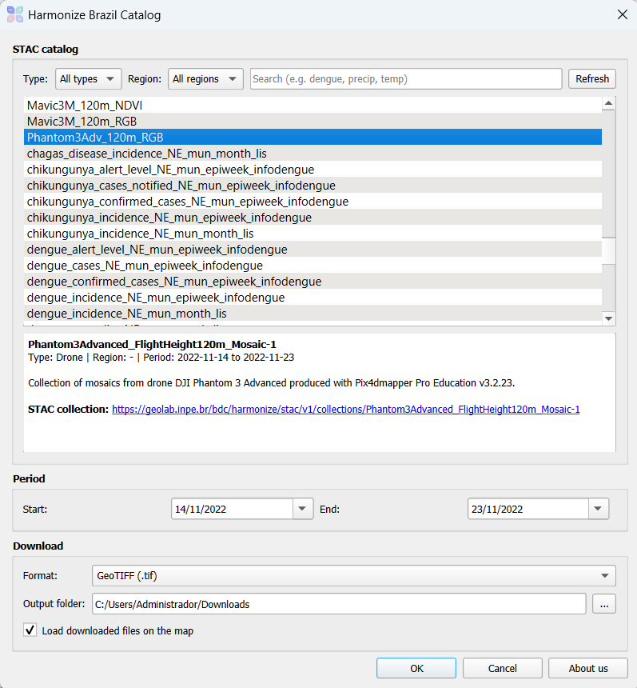
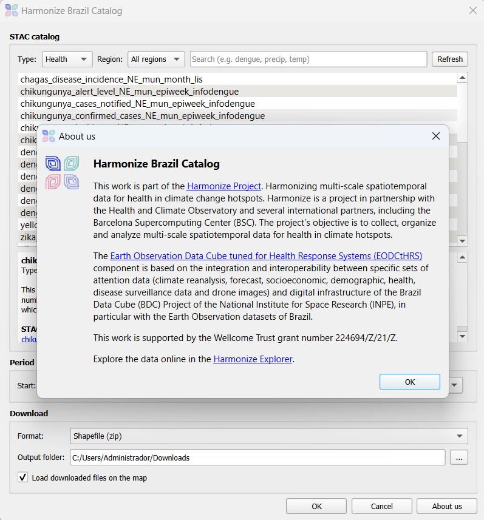
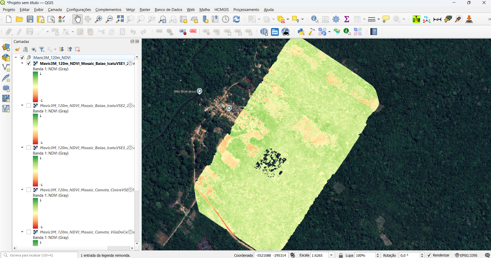

<p align="center">
  
</p>

<h1 align="center">Harmonize Brazil Catalog</h1>

<p align="center">
  QGIS plugin to search and download drone, health and climate data from the
  <a href="https://harmonize-brazil.github.io/">Harmonize Brazil</a> STAC catalog.
</p>

<p align="center">
  <a href="#english">English</a> · <a href="#português">Português</a>
</p>

---

## English

### Overview

**Harmonize Brazil Catalog** gives QGIS users direct access to the datasets published by the Harmonize Brazil project through its [STAC catalog](https://geolab.inpe.br/bdc/harmonize/stac/v1/collections). Users can browse the available collections, filter them by type and region, download the data for a chosen period and load it into QGIS, ready for temporal analysis.

> The plugin is under development and is currently flagged as **experimental**.







### Features

- Browse all collections of the Harmonize Brazil STAC catalog.
- Filter by **type** (Drone, Health, Climate), **region** (Northeast, North) and free text.
- Collection details with description, temporal extent and a link to the STAC record.
- Download by date range:
  - **Drone** imagery: GeoTIFF.
  - **Climate and health** (municipal indicators): GeoJSON or Shapefile (zip).
- Size check before downloading, with a confirmation prompt when the total exceeds 50 MB.
- Local cache: files already downloaded are reused.
- Downloads run in the background, with progress and cancellation in the QGIS task bar.
- Layers are loaded with styling (graduated symbology for vectors, RdYlGn ramp for NDVI) and configured for the **Temporal Controller**.
- Interface in **English** and **Brazilian Portuguese**, following the QGIS language setting.

### Available data

| Type | Examples | Spatial unit | Temporal aggregation | Sources |
|---|---|---|---|---|
| Drone | RGB, multispectral and NDVI orthomosaics | Flight area | Per flight | Harmonize field campaigns |
| Health | Dengue, chikungunya, Zika, yellow fever (cases, incidence, alert level) | Municipality | Epidemiological week, month | InfoDengue, LIS |
| Climate | Precipitation, temperature, relative humidity, temperature anomalies | Municipality | Epidemiological week, month | ERA5-Land (CDS), MERGE and SAMeT (CPTEC/INPE), INMET |


### Requirements

- QGIS 3.22 or later.
- Internet access to `geolab.inpe.br`.

No additional Python packages are required.

### Installation

**From a ZIP file**

1. Download the latest release from the [Releases](https://github.com/Harmonize-Brazil/harmonize_brazil/releases) page.
2. In QGIS, open *Plugins > Manage and Install Plugins > Install from ZIP*.
3. Select the file and click *Install Plugin*.
4. In the *Settings* tab, enable *Show also experimental plugins* if the plugin does not appear.

**From source (development)**

```bash
git clone https://github.com/Harmonize-Brazil/harmonize_brazil.git
```

Then create a link from the QGIS plugins folder to the cloned repository.

Windows (Command Prompt as administrator):

```bat
mklink /D "%APPDATA%\QGIS\QGIS3\profiles\default\python\plugins\harmonize_brazil" "C:\path\to\harmonize_brazil"
```

Linux:

```bash
ln -s /path/to/harmonize_brazil ~/.local/share/QGIS/QGIS3/profiles/default/python/plugins/harmonize_brazil
```

Restart QGIS and enable the plugin. The [Plugin Reloader](https://plugins.qgis.org/plugins/plugin_reloader/) plugin is recommended for development.

### Usage

1. Open the plugin from the toolbar icon or from *Web > Harmonize Brazil Catalog*.
2. Filter and select a collection.
3. Set the start and end dates.
4. Choose the download format and the output folder.
5. Click **OK**. Progress is shown in the QGIS task bar.
6. Use the **Temporal Controller** (*View > Panels > Temporal Controller*) to navigate through the loaded periods.

Downloaded files are stored in `<output folder>/<collection id>/`.

### Repository structure

```
harmonize_brazil/
├── __init__.py                       # QGIS entry point
├── metadata.txt                      # Plugin metadata
├── harmonize_brazil.py               # Plugin class: menu, toolbar, workflow
├── harmonize_brazil_dialog.py        # Dialog logic
├── harmonize_brazil_dialog_base.ui   # Dialog layout (Qt Designer)
├── harmonize_core.py                 # STAC access, download, layer loading
├── harmonize_tasks.py                # Background tasks (size check, download)
├── i18n/                             # Translations (.ts source, .qm compiled)
└── icon.png
```

### Translations

Source strings are written in English. To update the Brazilian Portuguese translation after changing the interface or messages, run in the OSGeo4W Shell (Windows) or a terminal with Qt tools (Linux):

```bash
cd i18n
pylupdate5 -noobsolete harmonize_brazil.pro
linguist HarmonizeBrazil_pt_BR.ts
lrelease HarmonizeBrazil_pt_BR.ts
```

### Contributing

Bug reports and suggestions are welcome in the [Issues](https://github.com/Harmonize-Brazil/harmonize_brazil/issues) page. Pull requests should describe the change and, when the interface is affected, update the translation files.

### About the project

This work is part of the [Harmonize Project](https://www.harmonize-tools.org/): Harmonizing multi-scale spatiotemporal data for health in climate change hotspots. Harmonize is a project in partnership with the Health and Climate Observatory and several international partners, including the Barcelona Supercomputing Center (BSC).

The [Earth Observation Data Cube tuned for Health Response Systems (EODCtHRS)](https://harmonize-brazil.github.io/) component integrates climate, socioeconomic, demographic, health, disease surveillance and drone data with the digital infrastructure of the Brazil Data Cube (BDC) project of the National Institute for Space Research (INPE).

### Funding

This work is supported by the Wellcome Trust grant number 224694/Z/21/Z.

### License

This plugin is distributed under the [GNU General Public License v2.0 or later](LICENSE).

Data provided through the STAC catalog follow the licenses stated in each collection (most are Creative Commons Attribution 4.0 International).

---

## Português

### Visão geral

O **Harmonize Brazil Catalog** dá acesso direto, no QGIS, aos conjuntos de dados publicados pelo projeto Harmonize Brazil por meio do seu [catálogo STAC](https://geolab.inpe.br/bdc/harmonize/stac/v1/collections). É possível navegar pelas coleções, filtrá-las por tipo e região, baixar os dados de um período e carregá-los no QGIS, prontos para análise temporal.

> O plugin está em desenvolvimento e marcado como **experimental**.

### Funcionalidades

- Navegação por todas as coleções do catálogo STAC do Harmonize Brazil.
- Filtros por **tipo** (Drone, Saúde, Clima), **região** (Nordeste, Norte) e texto livre.
- Detalhes da coleção com descrição, período disponível e link para o registro no STAC.
- Download por período:
  - Imagens de **drone**: GeoTIFF.
  - **Clima e saúde** (indicadores municipais): GeoJSON ou Shapefile (zip).
- Verificação do tamanho antes do download, com confirmação quando o total passa de 50 MB.
- Cache local: arquivos já baixados são reaproveitados.
- Downloads em segundo plano, com progresso e cancelamento pela barra de tarefas do QGIS.
- Camadas carregadas com simbologia (graduada para vetores, rampa RdYlGn para NDVI) e configuradas para o **Controlador Temporal**.
- Interface em **inglês** e **português do Brasil**, conforme o idioma do QGIS.

### Requisitos

- QGIS 3.22 ou superior.
- Acesso à internet para `geolab.inpe.br`.

Não é necessário instalar pacotes Python adicionais.

### Instalação

1. Baixe a versão mais recente na página [Releases](https://github.com/Harmonize-Brazil/harmonize_brazil/releases).
2. No QGIS, abra *Complementos > Gerenciar e instalar complementos > Instalar a partir do ZIP*.
3. Selecione o arquivo e clique em *Instalar complemento*.
4. Na aba *Configurações*, marque *Mostrar também complementos experimentais* se o plugin não aparecer.

Para desenvolvimento, clone o repositório e crie um link para a pasta de plugins do QGIS, conforme descrito na seção em inglês.

### Uso

1. Abra o plugin pelo ícone na barra de ferramentas ou em *Web > Harmonize Brazil Catalog*.
2. Filtre e selecione uma coleção.
3. Defina as datas de início e fim.
4. Escolha o formato e a pasta de saída.
5. Clique em **OK**. O progresso aparece na barra de tarefas do QGIS.
6. Use o **Controlador Temporal** (*Exibir > Painéis > Controlador Temporal*) para navegar pelos períodos carregados.

Os arquivos ficam em `<pasta de saída>/<id da coleção>/`.

### Sobre o projeto

Este trabalho faz parte do [Projeto Harmonize](https://www.harmonize-tools.org/), em parceria com o Observatório de Clima e Saúde e parceiros internacionais, entre eles o Barcelona Supercomputing Center (BSC). O componente [Earth Observation Data Cube tuned for Health Response Systems (EODCtHRS)](https://harmonize-brazil.github.io/) integra dados climáticos, socioeconômicos, demográficos, de saúde, de vigilância de doenças e de drone à infraestrutura do projeto Brazil Data Cube (BDC), do Instituto Nacional de Pesquisas Espaciais (INPE).

### Financiamento

Este trabalho é financiado pelo Wellcome Trust, processo nº 224694/Z/21/Z.

### Licença

O plugin é distribuído sob a [GNU General Public License v2.0 ou posterior](LICENSE). Os dados seguem as licenças indicadas em cada coleção do catálogo (em sua maioria, Creative Commons Attribution 4.0 International).
